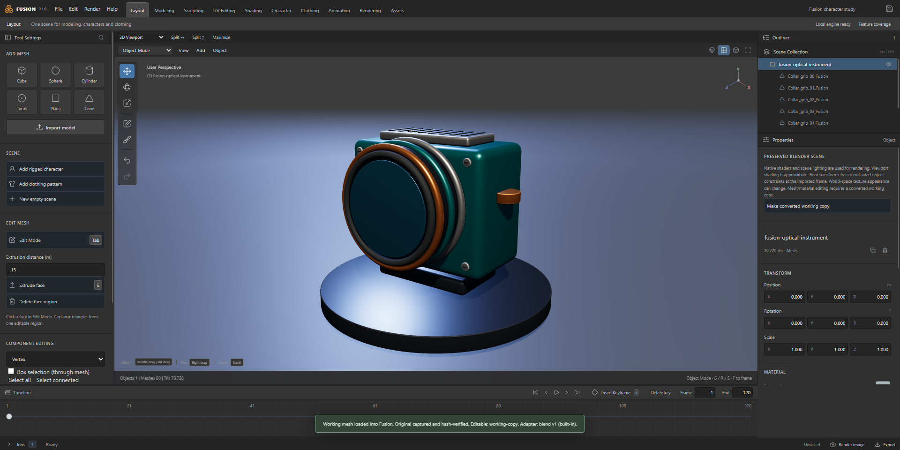
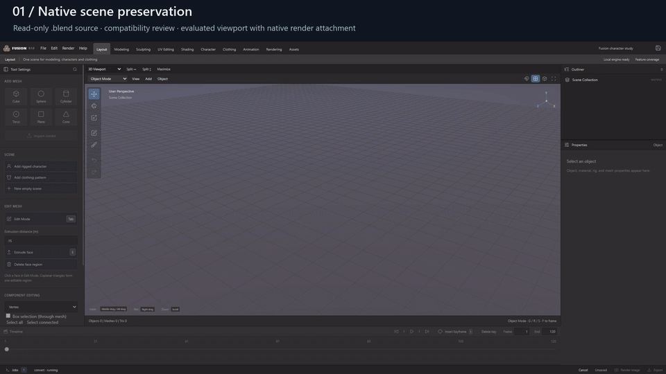
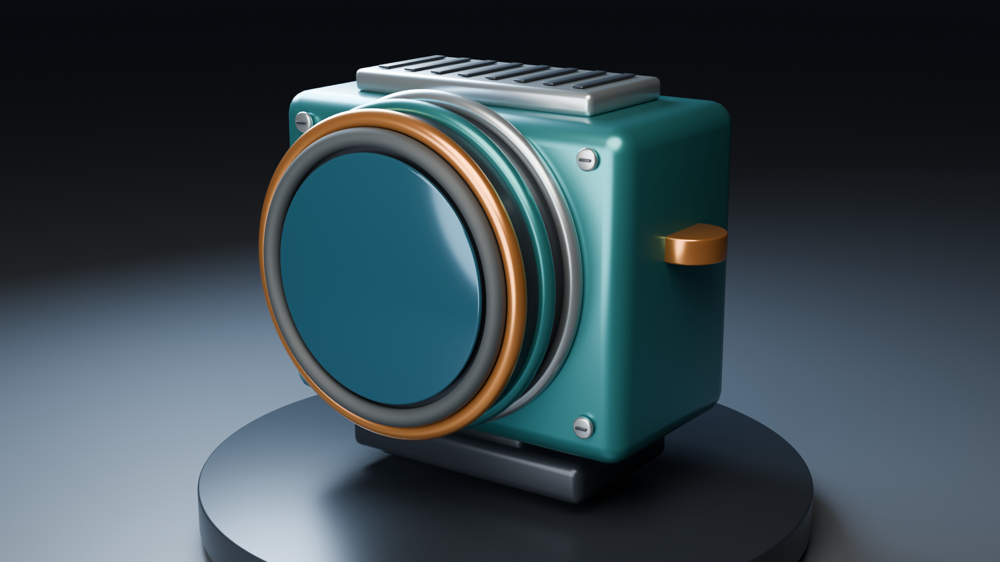
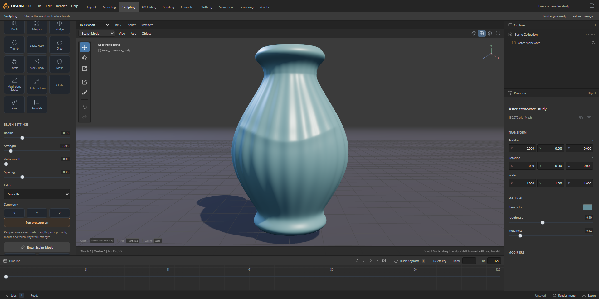
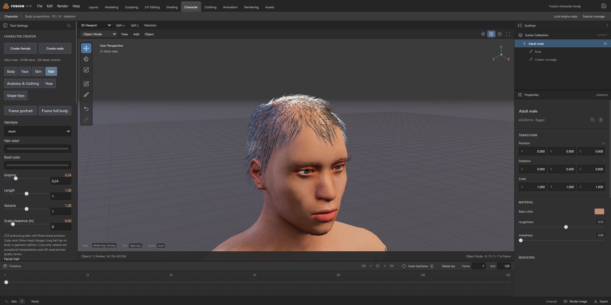

# Fusion Studio

**A connected 3D workspace built around the integrity of your files.**

Fusion Studio is a Windows desktop application for moving supported 3D work between tools while keeping the original, its meaning, and the limits of each conversion visible. Modeling, sculpting, character creation, pattern clothing, posing, animation, and rendering share a Blender-inspired interface, one scene, and a recoverable project workflow.

The long-term goal is a dependable middle workspace for many 3D applications. The current application implements specific, tested paths toward that goal. It does **not** claim that every native format can already be edited or converted without loss.

**Current snapshot:** `0.1.0` · Windows desktop · Electron / Three.js / Rust · local processing

[Workflow videos](#watch-real-workflows) · [Features](#work-inside-one-scene) · [File support](#file-support-and-fidelity) · [Run from source](#run-from-source) · [Architecture](fusion-studio/ARCHITECTURE.md) · [Implementation evidence](fusion-studio/docs/muse-implementation-status.md)



*A detailed, original optical instrument imported from Blender. The viewport is an evaluated representation; the native scene is retained separately for supported rendering. Screenshot from the actual application.*

## What Fusion is for

An artist's file is more than a triangle mesh. It can contain a source cage, a rig, shape keys, UV seams, material assignments, textures, modifiers, dependencies, animation, and application-specific data. Converting everything to a display mesh can leave a convincing picture while discarding the editable work behind it.

Fusion treats those concerns separately:

- **Keep the original.** Source-capsule records identify originals with SHA-256 and report inventoried dependencies. Export Original creates a verified new copy through the supported path; it does not apply later Fusion edits to that original.
- **Know what is editable.** A format adapter describes the supported subset. Native rendering, editable geometry, and verified native roundtrip are different capabilities.
- **Review a conversion before using it.** Import and operation reports explain incompatible or approximate data. A converted working copy is labeled accordingly.
- **Continue in one workspace.** Supported modeling, character, clothing, posing, and rendering operations use the same scene, operator system, and history.
- **Keep a way back.** Shared undo, versioned Fusion projects, cancellation, and revision checks help keep interrupted or failed work recoverable.

Keeping an original beside an edited mesh is useful preservation; it does not make that mesh a lossless native roundtrip. Fusion's interface and documentation make that distinction explicit.

## Watch real workflows

These are **1920 × 1080 H.264 MP4 recordings**, captured from the running Electron application on October 26, 2026. Click a preview to open its video file on GitHub. The [full gallery](fusion-studio/docs/WORKFLOW-GALLERY.md) includes individual screenshots, chapter descriptions, provenance, and reproduction instructions.



*A short silent preview; complete chaptered MP4 recordings follow.*

### Native Blender scene → compatibility review → Cycles render

[](fusion-studio/docs/showcase/2026-10-26/native-workflow.mp4)

[**Watch the native-scene workflow — MP4**](fusion-studio/docs/showcase/2026-10-26/native-workflow.mp4)

Import an original, multi-part optical instrument; review the preserved-scene import mode; inspect it in Fusion; and render its retained camera, lighting, and materials with Cycles OptiX. The capture verifies that the source `.blend` SHA-256 remains unchanged after import and rendering. This demonstrates native **rendering preservation**, not arbitrary lossless native editing.

### Detailed mesh → sculpt → undo / redo → refine

[](fusion-studio/docs/showcase/2026-10-26/sculpt-workflow.mp4)

[**Watch the sculpting workflow — MP4**](fusion-studio/docs/showcase/2026-10-26/sculpt-workflow.mp4)

Work on an original **156,672-triangle** stoneware mesh with real Draw Sharp and Smooth strokes, inspect the surface, and recover edits through undo/redo. The recording harness checks the numeric vertex positions against the baseline and edited state. It does not certify every sculpt brush or topology operation.

### Adult character → appearance → pose → custom shape key → saved recipe

[](fusion-studio/docs/showcase/2026-10-26/character-workflow.mp4)

[**Watch the character workflow — MP4**](fusion-studio/docs/showcase/2026-10-26/character-workflow.mp4)

Create an adult character from the verified CC0 starter foundation, adjust body and face controls, change skin tone without changing facial structure, fit short hair, adjust greying, and apply contrapposto. Sculpt a custom cheek-contour shape on the neutral editing copy, mix its influence, keyframe it, and save the editable recipe. The harness reopens the project and checks recipe equality. The fully clothed capture uses the current **coverage preview shell**, not a production-fitted garment.

All featured assets are original procedural fixtures or verified CC0 starter content. The media does not use the owner's private Genesis characters or paid asset libraries. Titles are added outside the app image; viewport helper boxes are hidden for framing. No AI-generated interface, synthetic render replacement, or vendor UI is presented as Fusion.

## Work inside one scene

| Area | Current implementation | Practical scope |
| --- | --- | --- |
| **Workspace** | Blender-inspired workspaces, outliner, properties, split areas, timeline, F3 operator search, F9 adjust-last, transform tools | A shared scene and operator/history system rather than disconnected demos |
| **Modeling** | Vertex, edge, and face selection; box and connected selection; component transforms; split, dissolve, weld, delete, and region extrusion | Topology operations use explicit attribute remaps and compatibility checks; protected native or character data can require a working copy |
| **Modifier stacks** | Retained source cage, parameters, ordering, visibility, duplication, removal, Apply, and stage diagnostics | Supported operations evaluate through the Blender worker; parameter changes start from retained source geometry |
| **Sculpting** | 32 catalog entries across surface, plane, radial, drag, mask, pose, cloth, and annotation tools; falloff, strength, radius, spacing, pressure, symmetry, and autosmooth | Fusion implementations with defined limits; catalog presence is not vendor parity |
| **Mesh tools** | Mesh filters, masked edits, local Dyntopo refinement/Simplify, retained-source multires working copies, and bounded Blender voxel-remesh operations | Topology-changing work requires compatibility review; a subdivided copy is not a preserved native multires hierarchy |
| **Character creation** | Adult male/female presets, 229 body/face detail controls, measurements, locks/favorites/search, seeded randomization, custom shape keys | CC0 starter topology and compatible local-library families remain distinct |
| **Appearance** | 24 skin-tone presets and continuous controls, retained texture detail, roughness/microdetail settings, fitted hair, brow/lash and facial-hair previews | Preview subsurface shading is approximate; hair and portrait realism still have open quality gates |
| **Rigging and posing** | FK/IK, authored joint limits, rig-checked pose libraries, skin-weight painting, sparse morphs, supported DSON formula drivers and corrective dependencies | No blanket compatibility with every commercial rig, HD system, or proprietary shader |
| **Clothing** | Straight/cubic pattern boundaries, holes, internal lines, darts, partial seams, seam/ease inspection, fitted shirt drafting and grading | Original Fusion pattern data; native Marvelous project editing is not established |
| **Cloth** | Rust XPBD evaluation, directional constraints, body/self contact, pose-aware placement, cancellable draping, seam/strain/intersection diagnostics | Offline fitting; production layered/animated cloth and fabric calibration remain unfinished |
| **Animation** | Object, bone, IK, and morph keys; playback; supported imported clips and evaluated animation export | Export may sample evaluated motion rather than reproduce a proprietary dependency graph |
| **Rendering** | Installed Blender worker, Cycles CPU/CUDA/OptiX, protected native Blender rendering, retained character material sidecars | Requires a supported Blender installation and a working device; preview and final shaders can differ |
| **Interchange** | Direct supported DSON reading, glTF validation, source/dependency records, export reports and optional MikkTSpace tangents | Feature support is reported per route; a supported suffix is not a fidelity guarantee |

### Sculpting toolkit

The current catalog includes:

- **Build and carve:** Draw, Draw Sharp, Clay, Clay Strips, Layer, Inflate, Deflate, Blob, Crease, Crease Sharp, and Crease Polish.
- **Refine surfaces:** Smooth, Flatten, Contrast, Fill, Deepen, Scrape, Peaks, Pinch, Magnify, and Multi-plane Scrape.
- **Move forms:** Grab, Elastic Deform, Snake Hook, Nudge, Rotate, Thumb, Slide / Relax, and Pose.
- **Protect and mark:** persistent Mask plus scene-data annotations.
- **Artistic folds:** Cloth performs procedural wrinkle deformation; it is labeled separately from the garment solver and does not claim physical cloth simulation.

Mesh filters include smoothing, sharpening, relaxation, and a volume-preserving smoothing option. Dyntopo includes bounded refinement and local edge collapse with protected boundary/mask checks. Voxel remeshing estimates its grid budget before launching. Multires working copies retain their source and reject a level change that would discard intervening sculpt work.

The full requested tool specification and remaining acceptance work live in [plan.md](plan.md). Line/polygon annotation modes, exact vendor brush equivalence, full native multires transfer, and large-mesh interaction should not be inferred from the catalog alone.

### Character authoring without flattening the recipe

Generated characters retain an immutable topology family, stable source correspondence, sparse morph deltas, rig/refit data, and an editable recipe. Skin tone remains independent of facial shape. Custom shape-key authoring uses an isolated, neutral, unposed copy; applying the edit stores its delta and restores the character's controls and pose.

Imported compatible DAZ content uses its own source identities. Morphs, weights, textures, poses, and attachment bindings are never treated as interchangeable merely because two assets share a name. Private library content remains local and is not part of the redistributable starter foundation.

### Clothing with visible quality evidence

Fusion connects bodies, poses, editable pattern documents, evaluated garments, and render finishing. Linked changes can grade and re-drape a garment inside the same dependency transaction. Diagnostics expose seam gaps, strain, penetration, and mesh quality; an unconverged garment should remain visibly unconverged.

Current limits matter: difficult female shirt fits remain unacceptable in recorded fixtures; extreme raised-arm poses can exceed the offline drape budget and roll back; long hair has no body/garment collision. The gallery deliberately does not present those workflows as production-ready cloth.

## File support and fidelity

| Format | Current route | What to expect |
| --- | --- | --- |
| **`.blend`** | Preserved native scene for supported rendering, plus evaluated viewport; separate editable interchange mode | Original-file protection and source attachment are distinct from editable conversions. New converted `.blend` output does not imply preservation of every original graph, rig, modifier, or native feature. |
| **DAZ `.duf` with `.dsf` dependencies** | Direct read-only DSON importer for supported mesh, UV, sparse morph, rig/skin, pose, and formula data | Unsupported operations/features are reported. `.dsf` is used as dependency data; a registry entry does not imply every `.dsf` is a standalone importable scene. HD systems, exact proprietary deformation, and shaders remain limited. |
| **`.glb` / `.gltf`** | Validated exchange, scene inspection, resources/dependencies and export reports | Useful editable interchange for the declared subset. GLB is not the authoritative store for a native project's complete semantics. |
| **`.obj`, `.fbx`, `.stl`, `.ply`** | Installed Blender conversion routes | Geometry/rig/material capability varies by format and host. Review units, axes, topology, materials, animation, and export reports. |
| **USD / USDZ, Alembic** | Worker routes and capability records exist | Composition/layer, cache, and roundtrip fidelity are not yet qualified for general use. Do not assume editable native semantics. |
| **ZBrush `.ZPR` / `.ZTL`** | Preservation-only capability records; no verified ZBrush host/SDK/fixture workflow | Not an editable ZBrush importer. A real native adapter remains a roadmap gate; the ordinary import picker does not make every registry entry available. |
| **Marvelous `.zprj` / `.zpac`** | Preservation-only records; Fusion's editable patterns are its own data model | `.zprj` is a different format from ZBrush `.ZPR`. Native garment-project roundtrip remains unverified. |
| **Other native projects: `.max`, `.ma`, `.mb`, `.c4d`, `.hip`, `.lxo`** | Planned verified bridges / preservation records | No general native editing or lossless conversion claim. |
| **`.fusion`** | Fusion's editable project, document schema 2 | Retains supported recipes, authored scene data, references, and editor state. Missing resources still need relinking. |

The adapter registry is versioned, but dependency discovery and portable source-capsule storage remain active work. A recorded original path can become unavailable; Export Original requires a source location verified in the current session. Save/reopen support does not make all external resources automatically self-contained.

## Run from source

The current development environment uses **Windows, Node.js 24, Python 3, and Blender 5.2**. Blender supplies background conversion, modifier, UV, and rendering jobs. Rust/native features require a matching built native module. Browser mode provides the editor canvas, not desktop file/engine access.

```powershell
cd fusion-studio
npm ci
npm run build:native
npm run build
npm start
```

`build:native` uses the project's Windows toolchain script; inspect its prerequisites before using a different machine. Keep native source and module provenance aligned. `npm run package` builds native code first and creates the Windows directory package. Existing releases are preserved separately.

For the redistributable character foundation, install the Python script dependencies (Pillow and NumPy) in your development environment, then run:

```powershell
python scripts/fetch-character-foundation.py
python scripts/compile-character-foundation.py
python scripts/prepare-character-skins.py
```

The scripts fetch pinned CC0 asset data and build local runtime files. Character binaries and private content libraries are not committed to this repository. See [dependency/provenance records](fusion-studio/docs/DEPENDENCIES.md) for the source revisions, authors, licenses, and retained hashes.

For UI development only:

```powershell
npm run dev
```

Do not treat browser-only file controls as a substitute for the desktop bridge. Host-dependent format support must be verified on the machine running Fusion.

## Architecture

```text
Menus / tool gestures / shortcuts / F3
                  |
      Operator dispatcher and preflight
                  |
     Versioned scene + shared undo history
      /                |                \
Three.js viewport   Rust helper      Persistent Blender worker
interactive edits   topology/cloth   conversion/modifiers/Cycles
      \                |                /
       Revision-checked results and diagnostics
                  |
       Fusion project / reviewed export
```

The existing implementation uses Electron, Three.js, an original Rust geometry module through napi-rs, and an installed Blender process. It does not embed commercial DAZ, Character Creator, Marvelous Designer, or ZBrush engines. The approved long-term Rust/WASM direction is separate from the currently shipped native helper.

Worker results carry operation identity/revisions where supported; stale results are rejected. Completed user gestures belong in a single history transaction. Failures and cancellation should retain the last consistent scene. The [architecture](fusion-studio/ARCHITECTURE.md), [ADRs](fusion-studio/docs/adr/), and [implementation ledger](fusion-studio/docs/muse-implementation-status.md) describe exact boundaries and work still in progress.

## Validation and performance

The repository includes numerical, serialization, UI, native-worker, interchange, character, garment, render, cancellation, and packaged-executable tests. Run focused checks first and broader regressions for release qualification:

```powershell
cd fusion-studio
npm test
npm run test:sculpt
npm run test:creator-core
npm run test:interchange
npm run test:packaged
```

Some integration suites require the local native module, a supported Blender build, or private fixtures. A missing host/fixture is a missing gate, not evidence of a pass. BMW CPU/OptiX comparisons remain fixture-specific renderer checks.

The current implementation ledger records **31–80 ms warm character previews** and approximately **55 FPS orbit** on its detailed local scene. Completed edits still take about **0.5–0.7 seconds**, including history capture. Sculpt kernel measurements of approximately **8.2 ms per dab at 190k triangles** exclude rendering, upload, and history; they are not end-to-end interaction guarantees. These are recorded test-PC results, not portable hardware specifications.

The new gallery has its own [machine-readable capture evidence](fusion-studio/docs/showcase/2026-10-26/capture-manifest.json). It records which actions were actually checked for the published media rather than treating screenshots as test results.

## Development status

The current `0.1.0` Windows directory build is a development release. The packaged-executable smoke workflow is recorded in the [implementation status](fusion-studio/docs/muse-implementation-status.md). Earlier v0.0 and packaged releases remain preserved; the Fusion project schema stays at version 2.

Active priorities include:

1. Broader dependency inventories, portable preservation capsules, and independently verified native roundtrips.
2. A legitimate, fixture-tested ZBrush adapter and additional native bridges.
3. Sculpt correctness/coverage, larger-mesh interaction, and safe topology transfer.
4. Portrait-quality assets, complete compatible character-library support, and reliable attachments.
5. Production garment fit, layered/animated cloth, calibrated fabrics, and dense-mesh acceptance.
6. Better automated recovery, interoperability fixtures, and complete distribution notices.

See the [implementation ledger](fusion-studio/docs/muse-implementation-status.md) for current milestone evidence, [feature coverage](fusion-studio/FEATURE-COVERAGE.md) for area-specific scope, and [roadmap](fusion-studio/docs/ROADMAP.md) for longer-term work. Dated reports describe the build at their checkpoint; older version labels and timings are historical.

## License and asset boundaries

Original Fusion Studio code is [MIT-licensed](fusion-studio/LICENSE). Third-party components retain their own licenses and notices. Verified CC0 starter assets have separate provenance; commercial runtimes, proprietary decompiler output, private characters, and paid assets are not part of that license or the application distribution.

Blender is an external installed processing dependency. Fusion is independently developed and is not endorsed by Blender, DAZ, Reallusion, Marvelous Designer, or Maxon. Review [DEPENDENCIES.md](fusion-studio/docs/DEPENDENCIES.md) and the recorded native/runtime notice limitations before distributing a build.
