# Fusion Studio

**One integrated 3D workspace for modeling, characters, clothing and rendering — no application switching.**

Fusion Studio combines a Blender-style editor, a character creator, pattern-based clothing design with cloth simulation, animation and Blender-backed rendering in a single Windows desktop app. It reads supported DAZ DSON content directly, validates glTF before import, and keeps every workflow in one scene with one undo history.

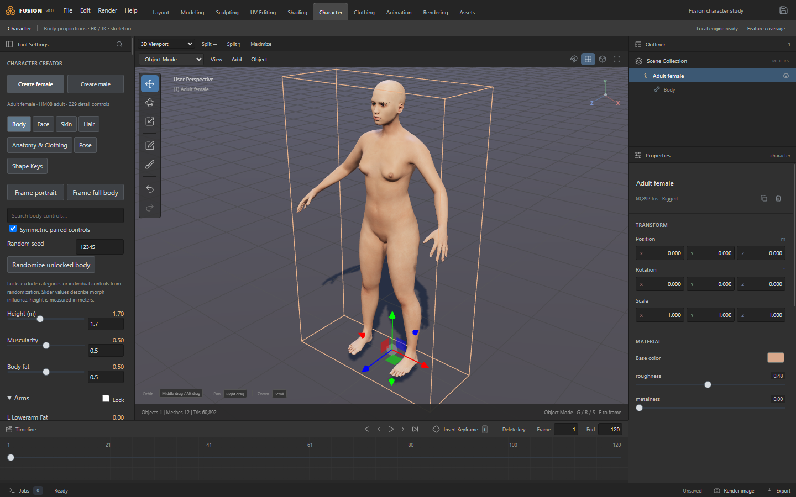

## Demo: character → clothing workflow

The whole pipeline in six steps, captured from the running app (`npm run showcase`):

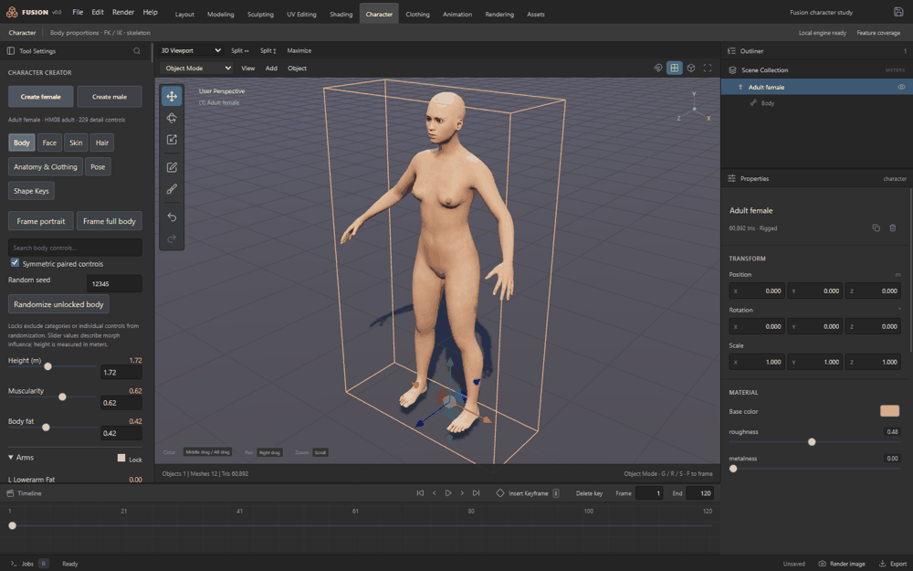

1. **Create & shape** — Create female, then height 1.72 m, muscularity and body-fat shaping with 229 detail controls.
2. **Face** — face-tab morph controls.
3. **Skin & hair** — skin-tone preset, long hairstyle with fitted strand preview (portrait framing shown below).
4. **Pose** — contrapposto preset from the Pose tab (standing restored before fitting).
5. **Make clothing** — Clothing → *Fit T-shirt to target character*: retained panels are graded to her body and draped with the Rust XPBD solver. The panel reports live diagnostics (here: 1,344 vertices, 5.9 mm mean seam gap, flagged "Needs refinement" — Fusion shows its fit limits instead of hiding them).
6. **Inspect fit** — *Show strain colors* heatmap: blue 0% → red ≥25% local edge strain, hot at the right shoulder.

| 1 · Body | 2 · Face |
| --- | --- |
| 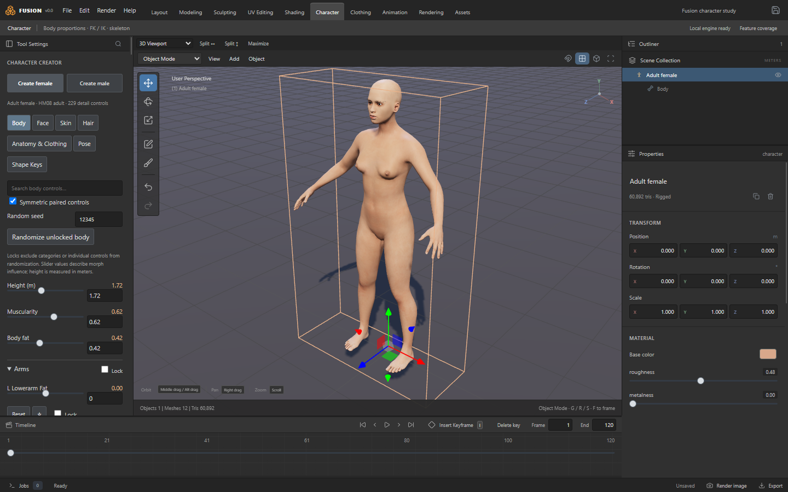 | 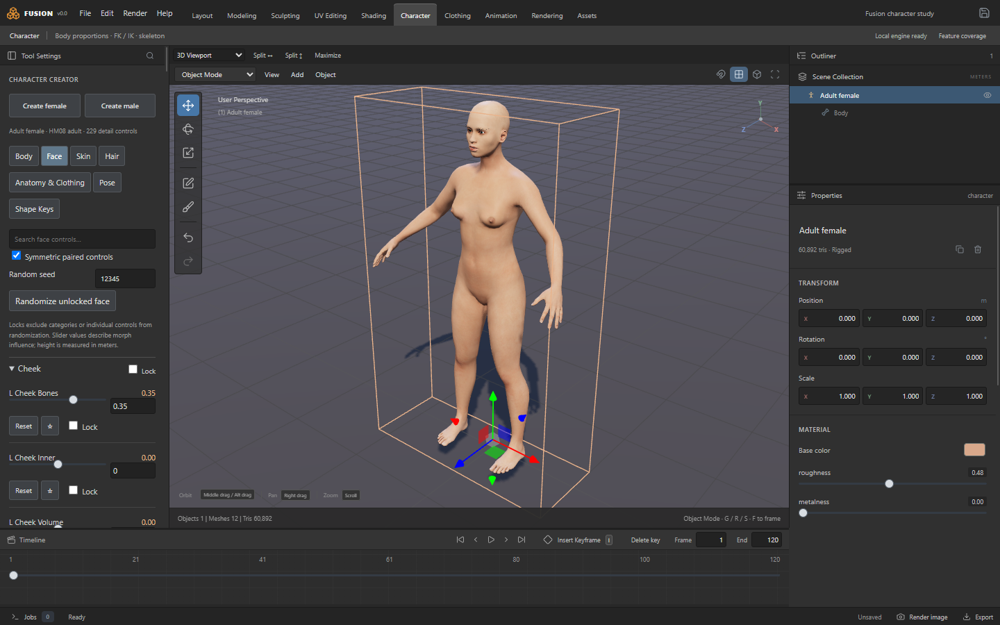 |

| 3 · Skin & hair | 4 · Pose |
| --- | --- |
| 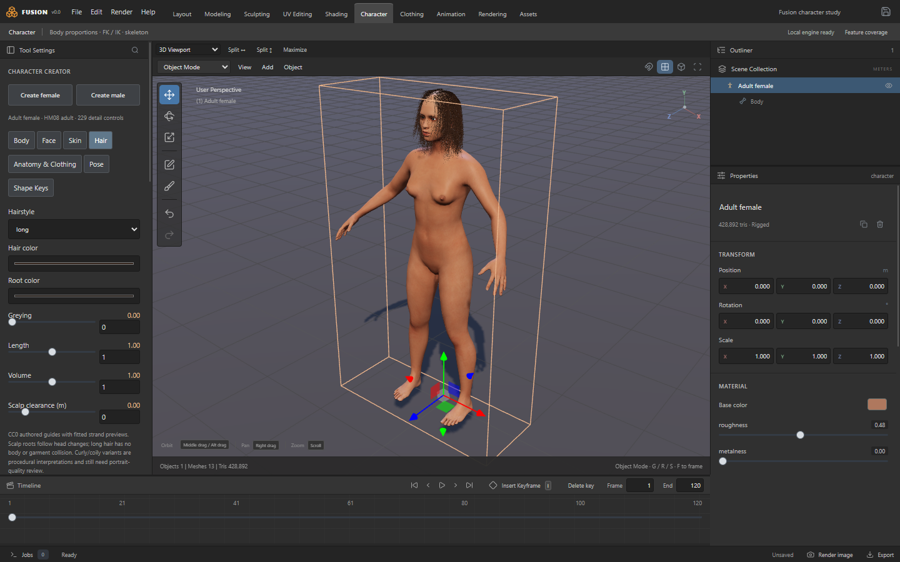 | 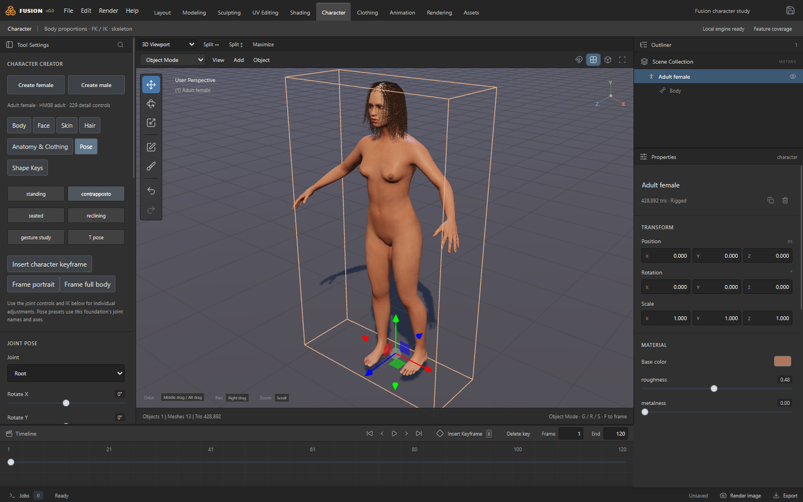 |

| 5 · Draped T-shirt | 6 · Strain inspection |
| --- | --- |
| 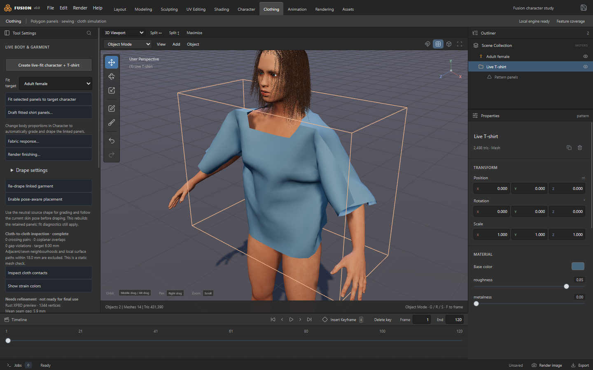 | 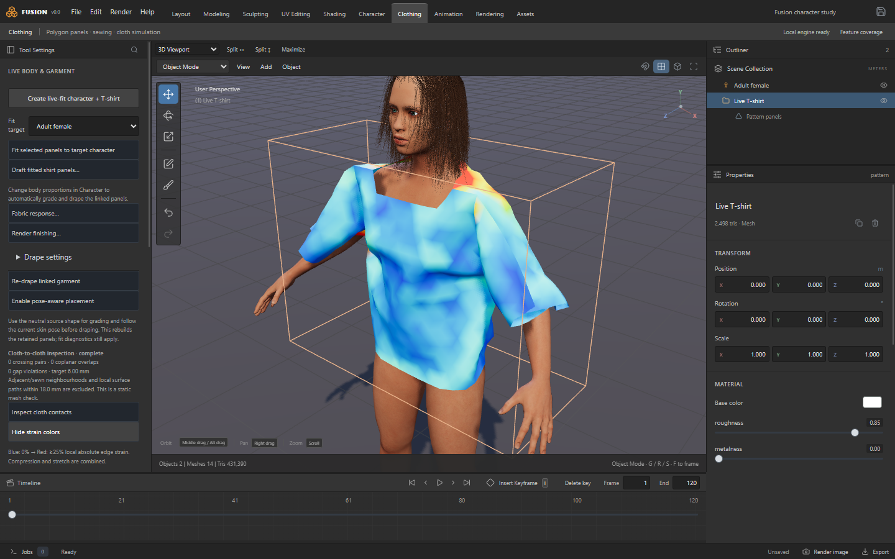 |

Live sculpting with the brush panel — Draw brush strokes on a sphere, straight from the real app:

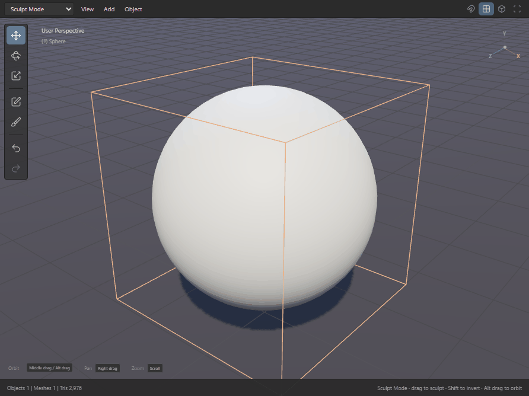

Regenerate this media any time with `npm run showcase` inside `fusion-studio/` (drives the real Electron UI via Playwright, then assembles the GIF).

## Showcase

All screenshots below are captured from the running app by `npm run showcase` — real scenes, no mockups.

| Layout & modeling | Sculpting (17 brushes) |
| --- | --- |
| 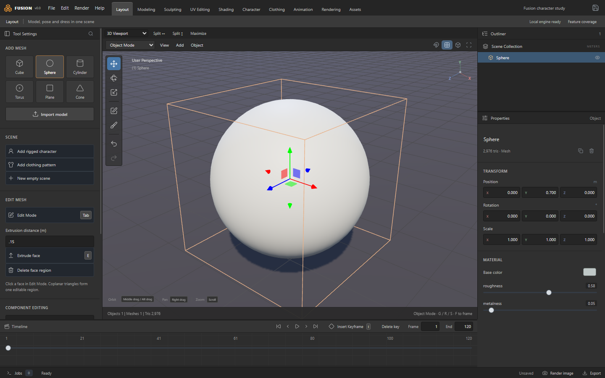 | 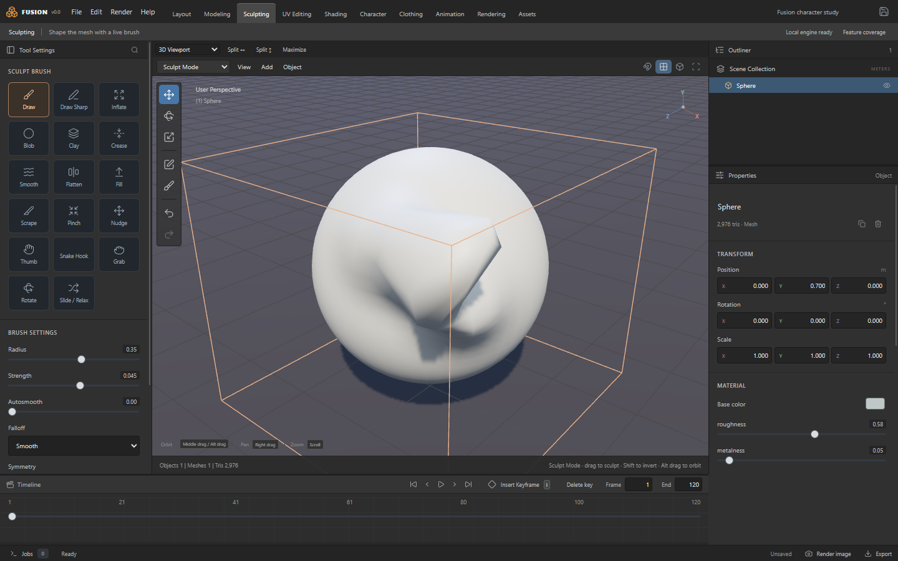 |

| Clothing: pattern skirt on the created character | Shading: Terracotta preset applied to the skirt |
| --- | --- |
| 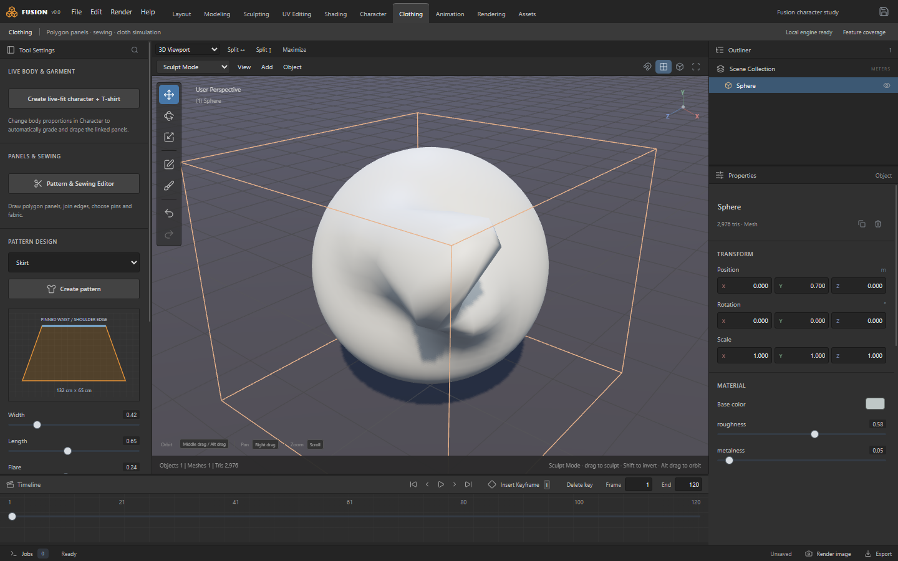 | 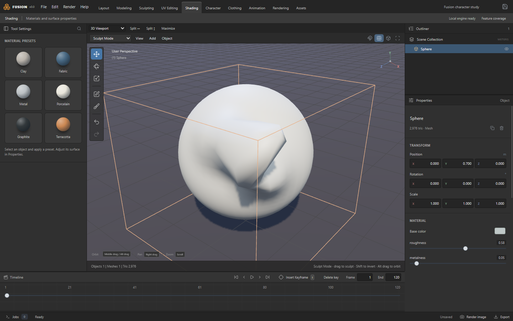 |

## What it does

| Area | Highlights |
| --- | --- |
| **Modeling** | Vertex/edge/face and component editing, retained-source modifier stacks, extrude/split/dissolve/weld, operator system with F3 search and F9 adjust-last |
| **Sculpting** | 17 brushes: Draw, Draw Sharp, Inflate, Blob, Clay, Crease, Smooth, Flatten, Fill, Scrape, Pinch, Nudge, Thumb, Snake Hook, Grab, Rotate, Slide/Relax — six falloff curves, autosmooth, X/Y/Z symmetry |
| **Characters** | Character Creator (body/face controls, shape-key sculpting, skin, hair, poses), parametric bodies, FK/IK with joint limits, pose libraries, weight painting, morphs and formula drivers |
| **Clothing** | Drawn/sewn pattern panels with darts, holes and partial seams, fitted shirt drafting from body surfaces, Rust XPBD cloth with body/self contact, strain and seam diagnostics |
| **Animation** | Object/bone/IK keyframes, timeline playback, evaluated GLB animation export |
| **Rendering** | Blender Cycles (CPU/CUDA/OptiX) with preserved native `.blend` scene fidelity |
| **Interchange** | Pre-import glTF validation and scene inspection, MikkTSpace tangent generation, GLB/FBX/OBJ/BLEND/STL/PLY routes, direct read-only DAZ DUF/DSF importer |

Compatibility is checked *before* an operation runs: warnings explain what is exact, approximate or unsupported, and Cancel always keeps the last valid scene.

## Quick start

```powershell
cd fusion-studio
npm ci
npm run build
npm start        # Electron desktop app
npm run dev      # browser canvas only (no local file/engine access)
```

Character data is not committed to this repo. Fetch and build it once:

```powershell
python scripts/fetch-character-foundation.py   # pinned CC0 MakeHuman/MPFB data -> assets/
python scripts/compile-character-foundation.py # -> public/characters/
python scripts/prepare-character-skins.py      # documented CC0 skin variants
```

Requires Node 20+, Python 3 with Pillow/NumPy for the asset scripts, and (for rendering/engine jobs) an installed Blender — developed against Blender 5.2 at `C:/Program Files/Blender Foundation/`.

## Tests

```powershell
npm test                  # 222 core tests
npm run test:sculpt       # sculpt brush engine
npm run test:creator      # Character Creator (builds first)
npm run test:interchange  # glTF validation + tangents
```

## Architecture

```text
Menus / shortcuts / F3 / tool gestures
            |
     Operator dispatcher        poll -> validate -> fidelity preflight -> transaction
            |
  Versioned document + history  (schema 2, deltas + snapshots, 200 steps)
       /              \
Rust native worker    Persistent Blender worker
cloth, contact,       modifiers, unwrap, Cycles
meshing (napi-rs)     (isolated, cancellable)
       \              /
     Three.js viewport + area editors
```

The document is authoritative; workers return revision-checked results and never silently replace the scene. Details: [ARCHITECTURE.md](fusion-studio/ARCHITECTURE.md), [FEATURE-COVERAGE.md](fusion-studio/FEATURE-COVERAGE.md), [docs/ROADMAP.md](fusion-studio/docs/ROADMAP.md).

## Status

v0.0 is a development snapshot, not a certified release. Production garment fit, layered/animated cloth, fabric calibration and dense interactive drape remain open — see the roadmap for honest per-area fidelity (Exact / Compatible / Inspired) and remaining gates.

## License

Original Fusion Studio code is MIT-licensed ([LICENSE](fusion-studio/LICENSE)). Third-party dependencies, the CC0 character foundation and any commercial content you load keep their own terms — see [docs/DEPENDENCIES.md](fusion-studio/docs/DEPENDENCIES.md).
