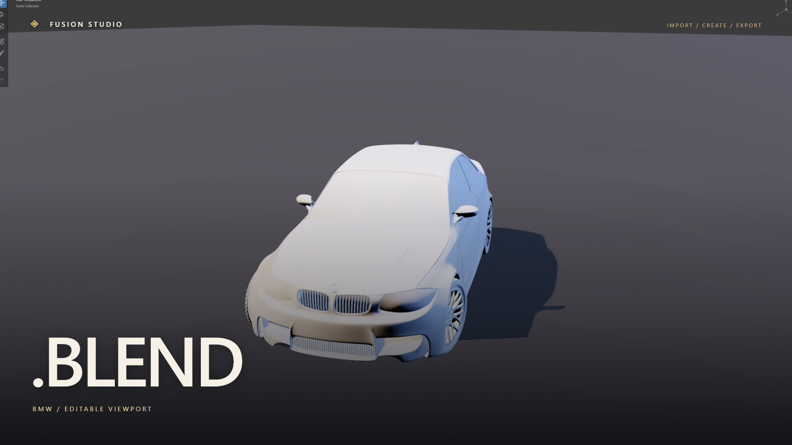
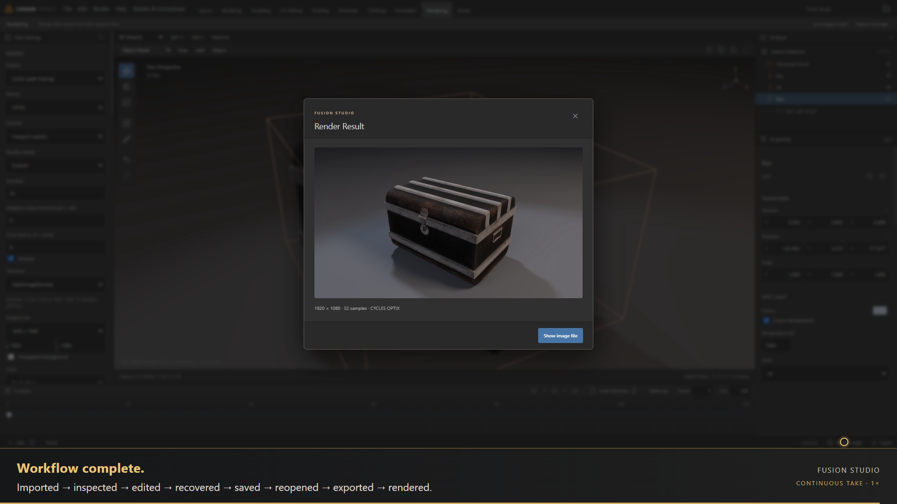

# Fusion Studio

**0.19.0-rc.1 · Windows x64 prerelease.** One workspace for supported imports, modeling, sculpting, character/clothing work, rendering and recoverable projects.

[Download Windows build](https://github.com/DiggityDooo/FusionStudio/releases/tag/v0.19.0-rc.1) · [Full project overview](../README.md) · [Quickstart](docs/releases/2026-11-03-rc-guide.md) · [Release evidence](docs/releases/2026-11-03-rc-report.md)

## Watch Fusion

[](docs/demo/2026-11-03-remotion/fusion-launch.mp4)

[Cinematic trailer MP4](docs/demo/2026-11-03-remotion/fusion-launch.mp4) · [Captions and evidence](docs/demo/2026-11-03-remotion/README.md)

[](docs/demo/2026-11-04-workflow/fusion-workflow.mp4)

[Continuous workflow MP4](docs/demo/2026-11-04-workflow/fusion-workflow.mp4) · [Captions, chapters and evidence](docs/demo/2026-11-04-workflow/README.md)

Trailer shows varied assets, Blender editable/preserved modes, DAZ preset recovery, sculpt/history/save, conversational local chat and external MCP edits. Continuous recording follows a static DAZ prop from compatibility review through wireframe, transform, undo/redo, save/reopen, GLB export, lighting and actual Cycles render. Full waits retained.

## Run packaged app

Extract the complete Windows ZIP into a writable folder and launch `win-unpacked/Fusion Studio.exe`. Keep all files together. Install Blender 5.2 separately; commercial applications, private DAZ libraries and model runtimes are not bundled. Projects and connection settings live in separate Fusion Data storage.

## Build from source

Use Windows x64, Node.js 22, Python 3 and Blender 5.2. Native build requires the toolchain described by [dependencies](docs/DEPENDENCIES.md).

```powershell
npm ci
npm run build:native
npm run build
npm start
```

Generate redistributable CC0 character runtime files with the [foundation setup steps](../README.md#run-from-source). Private assets remain local. `npm run package` builds the native module and Windows directory package.

## Scope and validation

Frozen candidate evidence records 1,191 default parallel passes, 47 native passes, and 44 packaged import cases across 42 source files. [Testing guide](docs/TESTING.md) separates portable CI from installed-Blender/private-fixture gates. Newer demo recordings do not expand native fidelity certification.

- Blender imports distinguish preserved native rendering from approximate editable interchange.
- DUF/DSF support is limited to tested base geometry, general weights, morphs and compatible presets. Native shader, HD, graft and strand-hair parity is not established.
- History, versioned `.fusion` projects, source hashes, cancellation and revision checks support recovery.
- Model profiles support compatible chat APIs and native Ollama. Chat is conversational. Authenticated local MCP exposes seven bounded scene tools. See [connections](docs/CONNECTIONS.md).
- Production cloth, portrait realism and universal lossless roundtrips remain unfinished. [Current limits](docs/releases/2026-11-03-rc-report.md) and [workflow-specific findings](docs/demo/2026-11-04-workflow/README.md) stay explicit.

[Architecture](ARCHITECTURE.md) · [Feature coverage](FEATURE-COVERAGE.md) · [Roadmap](docs/ROADMAP.md) · [License](LICENSE) · [Security](../SECURITY.md)

Original Fusion code is MIT-licensed. Third-party components and CC0 starter assets retain their separate notices/provenance. Blender is an external dependency; Fusion is independently developed.
