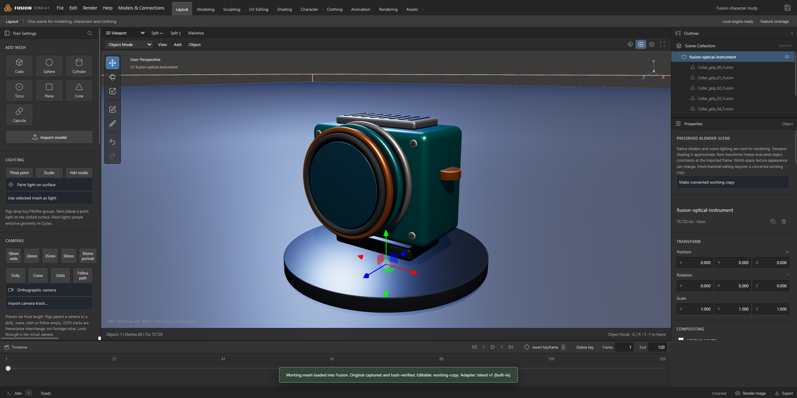

# Recorded Fusion workflows

Current gallery: [November 3 packaged candidate](demo/2026-11-03/README.md). Includes captioned 1080p video, representative screenshots, source/package hashes, capture assertions and decoded-media verification.

Demonstrates preserved Blender import/render, detailed sculpt and undo/redo, save/reopen/export, real local model chat and external MCP edits. Original procedural fixtures only; private content stays local.

[Release acceptance](releases/2026-11-03-rc-report.md) separately covers 44 import cases and packaged male/female garment workflows. [Live checks](verification/2026-11-03-live-connections.json) identify actual provider and independent Inspector version. Earlier recordings and reports retain their original dates and are not substituted for current demo.
