# Fusion Studio workflow gallery

Recorded October 26, 2026 · application 0.1.0 · actual Electron desktop application

This gallery presents three complete, captioned MP4 demonstrations with deliberate framing, detailed models, recoverable edits, and explicit capability boundaries. It documents the current development build rather than promising finished professional parity with every source application.

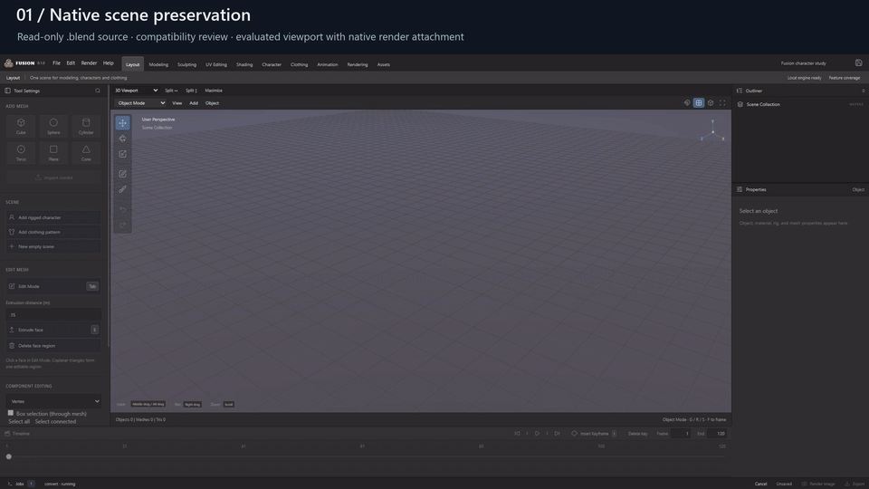

The silent reel is a short, edited preview. The complete videos below retain their individual workflow chapters. GitHub displays the animated GIF directly; the MP4 links open the repository's video files for playback or download. Full-resolution images open by clicking them.

## 1. Preserved Blender project to final render

[**Open the 1080p MP4**](showcase/2026-10-26/native-workflow.mp4) · [English captions](showcase/2026-10-26/native-workflow.vtt)

The optical instrument is an original, 80-mesh mechanical fixture with 70,720 evaluated triangles. Its anodized housing, metallic trim, fasteners, cooling fins, studio lights, and camera are authored in a new Blender file generated solely for this gallery.

1. Review the real Import Compatibility dialog and choose preserved native rendering.
2. Import an evaluated viewport representation with its protected native scene attachment.
3. Inspect the object in the shared Fusion workspace.
4. Render through Fusion's persistent Blender worker using the preserved camera, world, lights, and materials.

The final image is **1920 × 1080, 64 samples, Cycles OptiX**. It was computed through Fusion; it is not a pre-render swapped into the UI. The capture checks that the original `.blend` SHA-256 stays unchanged after importing and rendering. It does not claim unrestricted editable native roundtrip. Video duration: **22.87 seconds**.

| Compatibility review | Preserved-scene workspace |
| --- | --- |
| [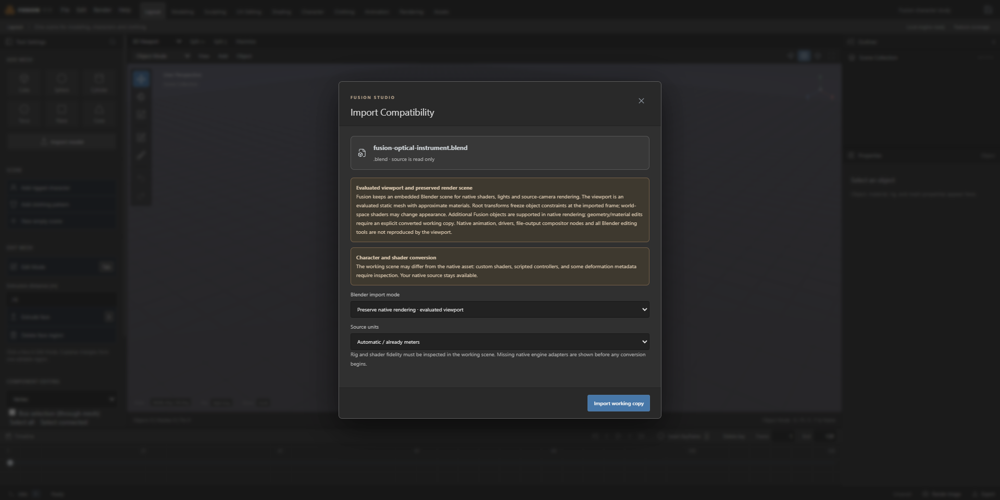](showcase/2026-10-26/native-import-review.png) | [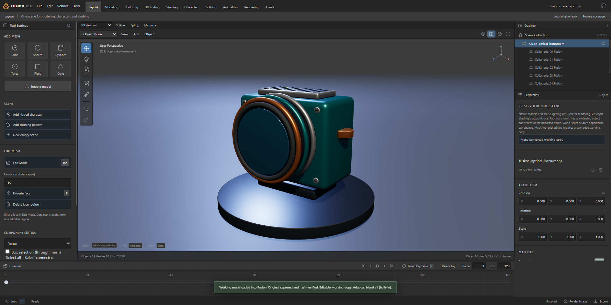](showcase/2026-10-26/native-workspace.png) |

[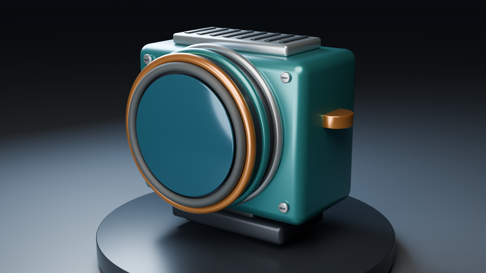](showcase/2026-10-26/optical-instrument-render.png)

*Actual final render, copied unchanged from the completed Fusion render job. [Render-result dialog in the application](showcase/2026-10-26/native-render.png).*

## 2. Detailed sculpting with verified recovery

[**Open the 1080p MP4**](showcase/2026-10-26/sculpt-workflow.mp4) · [English captions](showcase/2026-10-26/sculpt-workflow.vtt)

The Aster stoneware study is an original closed lathe mesh with an exterior, rim, interior wall, bottom, and **156,672 triangles**. It is imported through the actual validated GLB working-copy flow before recording.

1. Use Draw Sharp through real pointer strokes on the detailed surface.
2. Undo the completed gesture and verify the baseline vertex positions.
3. Redo it and verify the edited vertex positions.
4. Return to Sculpt Mode, refine with Smooth, and orbit the surface.

[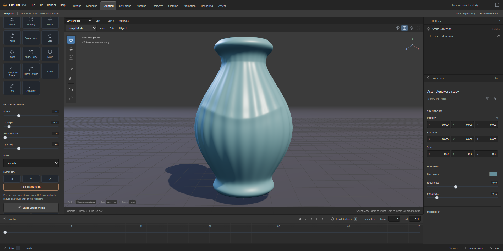](showcase/2026-10-26/sculpt-detail.png)

The harness compares SHA-256 over numeric Float32 position values, normalizing signed zero because JSON projects canonicalize `-0` to `0`. This is a numeric geometry comparison, not a claim that every serialized buffer remains byte-identical. Smooth selection, Sculpt Mode, and actual Smooth displacement are also checked. The recording demonstrates two brushes and recovery on this fixture; other brushes, masks, topology edits, and attributes have their own acceptance tests. Video duration: **24.24 seconds**.

## 3. Character customization and custom shape authoring

[**Open the 1080p MP4**](showcase/2026-10-26/character-workflow.mp4) · [English captions](showcase/2026-10-26/character-workflow.vtt)

The generated adult male uses the verified CC0 MakeHuman/MPFB starter family, 229 detail controls, and a scene containing approximately **432,934 triangles** including its strand hair and coverage preview. Source-cage shape authoring uses its separate neutral topology; it does not edit the posed viewport by subtracting posed coordinates.

1. Set height, muscularity, and body fat with visible numeric controls.
2. Adjust a face proportion from the Face category.
3. Change skin tones and roughness while retaining texture detail.
4. Inspect scalp-bound short hair and adjust greying.
5. Apply the contrapposto pose and save a new Fusion project version.
6. Sculpt a custom cheek-contour shape on the isolated neutral copy.
7. Apply the shape, mix its influence to 0.65, insert a character keyframe, and save.
8. Reopen the project in the harness and compare the complete saved recipe with the pre-reopen recipe.

| Body proportions | Texture-preserving skin controls |
| --- | --- |
| [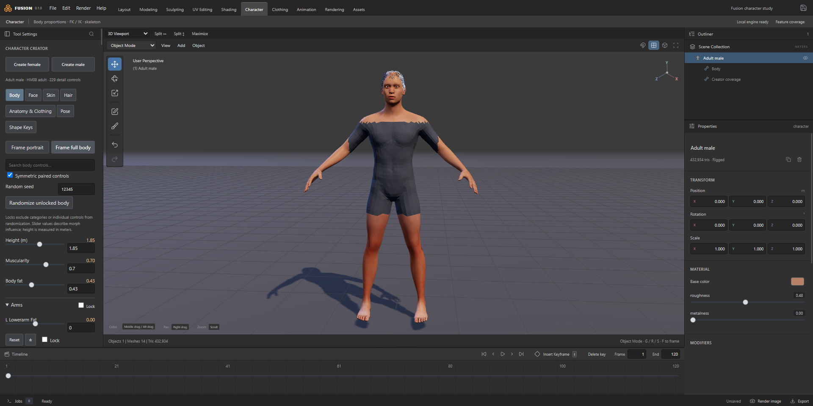](showcase/2026-10-26/character-body.png) | [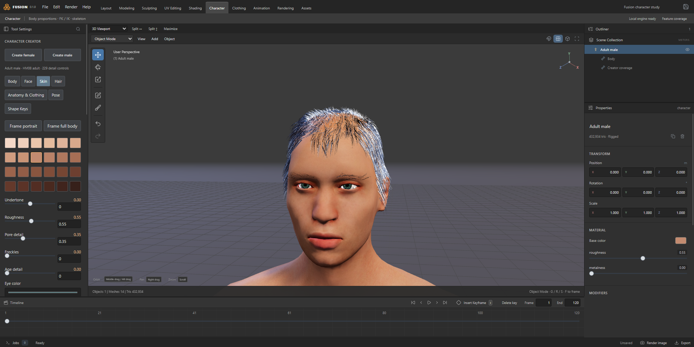](showcase/2026-10-26/character-skin.png) |

| Fitted hair portrait | Posed character |
| --- | --- |
| [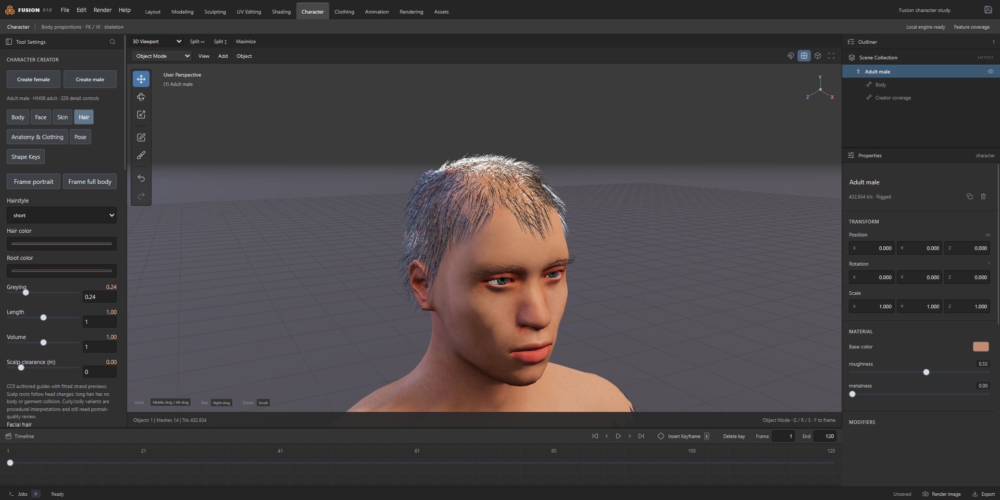](showcase/2026-10-26/character-portrait.png) | [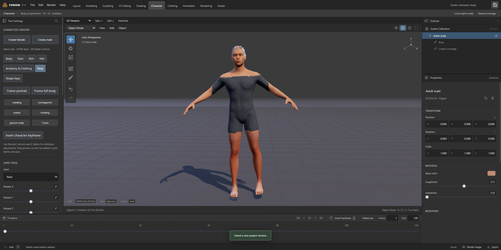](showcase/2026-10-26/character-pose.png) |

| Isolated neutral shape edit | Authored shape mixed on the character |
| --- | --- |
| [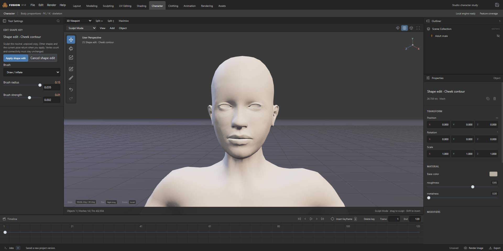](showcase/2026-10-26/character-shape-authoring.png) | [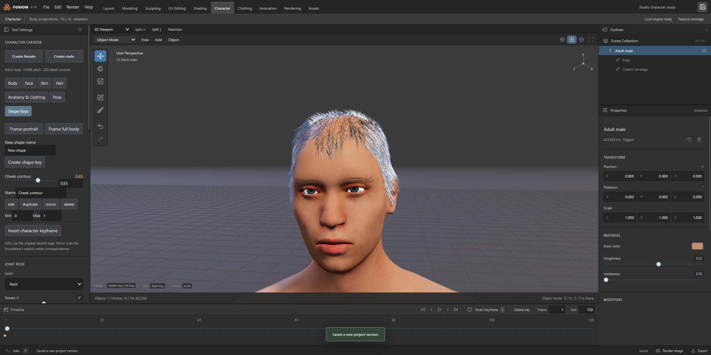](showcase/2026-10-26/character-shape-mixing.png) |

The full-body footage uses the fitted **starter coverage shell**. That shell is a visibility/coverage preview, not a production T-shirt. Hair uses strand previews; portrait realism, complete oral/nail assets, private-family fidelity, hair collision, and production garment fitting remain open gates. These visible limitations are not retouched out of the media. Video duration: **49.20 seconds**.

## Capture and provenance

- All app images are real pixels from the running 0.1.0 Electron build. The app image is 1920 × 960; an external 120-pixel title band produces the 1920 × 1080 MP4.
- Video files use H.264, 30 fps delivery, YUV 4:2:0, and fast-start metadata. Each contains named chapter markers, with a separate WebVTT caption track for compatible players. The captured frame cadence varies with app activity; delivery frame rate is not an app-performance measurement.
- The short GIF reel selects excerpts; chapter cuts omit setup and idle time. No AI-generated interface or synthetic result is inserted. The final still is the actual completed render output.
- Helper bounding boxes/transform gizmos are hidden for framing. The character's normal body/face/appearance/pose controls, shape actions, save workflow, and sculpt strokes run through the actual app interface.
- The capture uses a fresh `FUSION_DATA_DIR` per run. Existing projects, vendor installations, private libraries, earlier packages, and current product source are preserved.
- Mechanical and stoneware fixtures are newly authored procedural models. Their generator is original Fusion documentation code. The character foundation and skins are verified CC0 data; [dependency records](DEPENDENCIES.md) retain individual provenance and licensing.
- No private Genesis character, paid clothing, proprietary decompiler output, vendor executable, raw capture-frame directory, or local test profile is included in this gallery.
- The [capture manifest](showcase/2026-10-26/capture-manifest.json) lists the checks performed. The [media inventory](showcase/2026-10-26/media-inventory.json) records dimensions, durations, file hashes, sizes, and full video decode results. Neither document replaces the broader product test suite.

## Reproduce the media

Build the current application and prepare the local CC0 character runtime as described in the [root README](../../README.md). Install Playwright through the pinned development dependencies. Provide an FFmpeg executable through `FUSION_MEDIA_FFMPEG` and Pillow for final validation; capture tooling is development-only and is not packaged into Fusion.

Generate fixtures in an isolated Blender session. Substitute your legitimate Blender executable path:

```powershell
cd fusion-studio
$galleryScratch = Join-Path (Get-Location) 'test-output/github-showcase'
$env:BLENDER_USER_CONFIG = Join-Path $galleryScratch 'blender-config'
$env:BLENDER_USER_SCRIPTS = Join-Path $galleryScratch 'blender-scripts'
$env:BLENDER_USER_EXTENSIONS = Join-Path $galleryScratch 'blender-extensions'
$env:XDG_CACHE_HOME = Join-Path $galleryScratch 'cache'
& 'C:/Program Files/Blender Foundation/Blender 5.2/blender.exe' --background --factory-startup --disable-autoexec --python scripts/make-gallery-fixtures.py

$env:FUSION_MEDIA_FFMPEG = 'C:/path/to/ffmpeg.exe'
node scripts/capture-gallery.cjs all
python scripts/finish-gallery.py
```

The capture may also be run one workflow at a time with `character`, `sculpt`, or `native` instead of `all`. Read the scripts before running them. They create new local fixture/runtime outputs; they do not edit the installed Blender or user-owned source projects. Native capture explicitly selects OptiX and fails if unavailable rather than fabricating a GPU render.

The capture manifest is written only after a workflow completes its checks. Interrupted output is not release evidence. Review newly recorded images/videos for framing and unintended private content before updating the repository.
