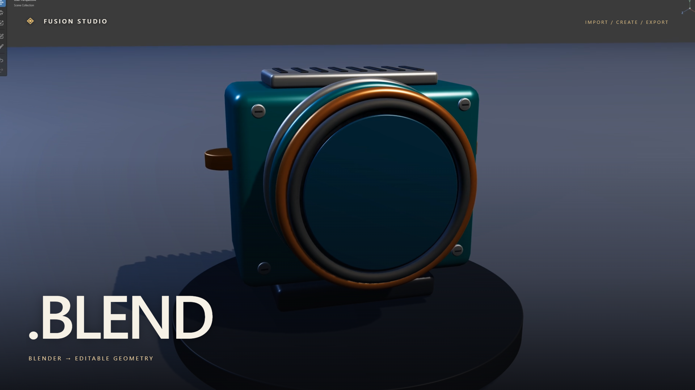

# Recorded Fusion workflows

Current gallery: [Two-minute film — launch trailer revision](demo/2026-11-03-remotion/README.md), with 39 beat-cut shots, large animated type, moving asset cards, split comparisons and focused app actions, Secret by ESPRIT 空想, captions, source/package hashes, fresh capture assertions, full decoding and independent frame checks.

Demonstrates Blender editable/preserved modes, local DAZ mesh/rig and supported preset recovery, sculpt and undo/redo, save/reopen/export, real local model chat and external MCP edits. Private source assets remain local. [Editable video tooling](../videos/fusion-launch/README.md) includes pinned dependencies and reproduction commands. [Original 86-second silent demo](demo/2026-11-03/README.md) retains its original evidence and procedural-only footage.

[Release acceptance](releases/2026-11-03-rc-report.md) separately covers 44 import cases and packaged male/female garment workflows. [Live checks](verification/2026-11-03-live-connections.json) identify actual provider and independent Inspector version. Earlier recordings and reports retain their original dates and are not substituted for current demo.
