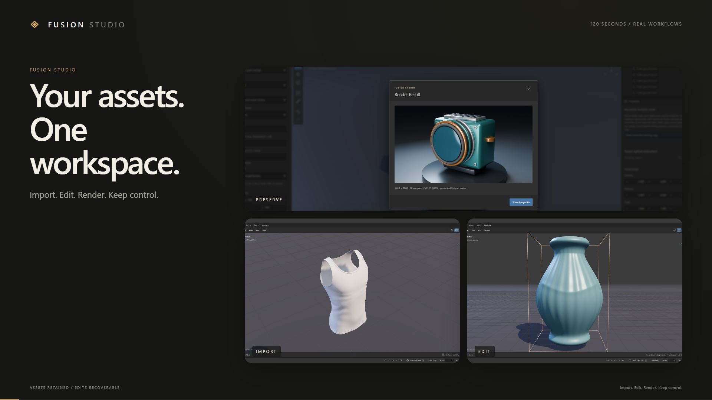
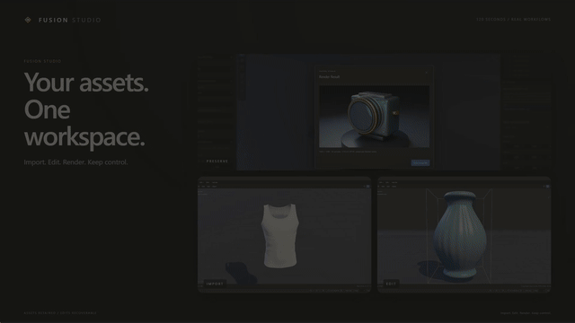

# Fusion Studio — two-minute Remotion film

[1080p MP4 with music](fusion-launch.mp4) · [English captions](fusion-launch.vtt) · [Shot overview](contact-sheet.jpg) · [Finish audit](FINISH.md) · [Verification](verification.json) · [Source provenance](provenance.json) · [Independent frame checks](determinism.json)

120 seconds, 1920 × 1080, 30 fps. Real packaged Fusion 0.19.0-rc.1 footage composed with Remotion **4.0.540**. Soundtrack: **Secret — ESPRIT 空想**, first two minutes of user-supplied recording, original speed, one-second opening fade and three-second closing fade. No narration. [Editable project and commands](../../../videos/fusion-launch/README.md).

| Section | Demonstration |
|---|---|
| Opening | Separate actual outputs: preserved optics render, imported garment, edited stoneware |
| Blender | Compatibility review; editable interchange and preserved native rendering identified separately |
| DAZ | Actual MuscleShirt .duf mesh/rig; compatible black 3Delight preset; undo/redo |
| Edit | Pointer-driven sculpt; exact geometry recovery; save/reopen and GLB export |
| Chat | Actual Phi-3 response through local Ollama; conversational chat only |
| MCP | Separate external official SDK client; inspect/add/transform/undo/redo |
| Finish | RC version, repository address, music credit |

Section timings follow measured music grid near planned boundaries; exact frames are in provenance and container chapters. Playback-rate badges identify sped-up captures; raw timestamps stay local. Automated input drives real app workflows. Only file-picker paths are stubbed. No simulated UI or model responses. Source/package hashes, decoded texture checks and recovery measurements are recorded.

**DAZ material limit:** this black 3Delight preset exposes supported color channel through current reader. Legacy black-texture shader channels are not reconstructed; original texture remains. Footage certifies supported transaction and recovery, not full 3Delight appearance parity. Texture pixels recover exactly; measured linear-color roundtrip drift is 1.017e-6 against capture bound 1e-5. Mesh, rig, source files and texture assets are not distributed here.

Production workflow adapted from [demo-video-creator](https://github.com/chacha95/demo-video-creator/tree/7947a8b4ee9b18c056945b16911bd229d9606251), pinned revision, with requested Remotion/music/caption adaptations. [Design](../../../videos/fusion-launch/DESIGN.md), [script](../../../videos/fusion-launch/SCRIPT.md), [decisions](../../../videos/fusion-launch/DECISIONS.md) and [reference notes](../../../videos/fusion-launch/SPEC.md) accompany editable project. Original music input, fonts and private captures remain local.

[Original 86-second silent verification demo](../2026-11-03/README.md) remains unchanged. [Release report](../../releases/2026-11-03-rc-report.md) separately establishes full acceptance matrix; film does not expand certification.
