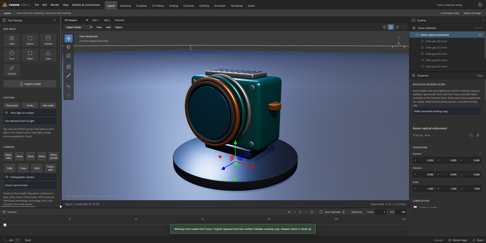
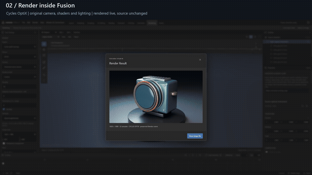

# Fusion Studio 0.19.0-rc.1 — recorded demo

[Watch H.264 MP4](fusion-studio-rc1-demo.mp4) · [English captions](fusion-studio-rc1-demo.vtt) · [capture evidence](capture-manifest.json) · [media verification](media-inventory.json)

Recorded November 3 from actual Windows candidate. Source is 1920 × 960 application pixels; chapter banners occupy separate 120-pixel band in 1920 × 1080 output. Silent video retains actual workflow actions and real local model replies. Scripted input drives UI; only OS file-picker paths are automated. No generated interface, replacement render or simulated model answer is presented as live work.

| Chapter | Demonstration | Verification |
|---|---|---|
| Preserve original | Import authored optical-instrument `.blend`, compatibility review, native attachment | Original SHA-256 retained |
| Native render | Render source camera/shaders/lights through Fusion with Cycles OptiX | Actual completed render dialog |
| Edit and recover | Pointer-driven Draw Sharp on 156,672-triangle stoneware fixture | Numeric geometry changes; undo/redo match hashes |
| Save and export | Save/reopen editable project and export GLB | Exact reopened numeric positions and real output file |
| Local model chat | Test profile and ask installed Phi-3 through Ollama | Actual inference, no scene upload or scene-agent claim |
| External MCP | Inspect, add cube, transform, undo and redo | Official SDK client and revision-validated real scene state |

Fixtures are original procedural assets generated by [make-gallery-fixtures.py](../../../scripts/make-gallery-fixtures.py). No private DAZ assets or paid library content appears in these recordings. Fixture source hashes and package ASAR hash are in capture manifest; meshes/Blender files stay outside Git.

Reproduce with [capture script](../../../scripts/capture-rc-demo.cjs) and [media verifier](../../../scripts/finish-rc-demo.py). Scripts require prepared fixtures, current packaged app, live local Ollama/Phi-3, local FFmpeg and demonstrated OptiX backend. [Full setup and tests](../../TESTING.md).

This demo shows bounded workflows. Native editable conversion and preserved rendering differ; advanced shaders/modifiers/instances, production cloth/portrait realism, general DAZ semantics and universal lossless roundtrips are not established by a video. [Release scope](../../releases/2026-11-03-rc-report.md) and [live model/MCP scope](../../CONNECTIONS.md) provide exact boundaries.
