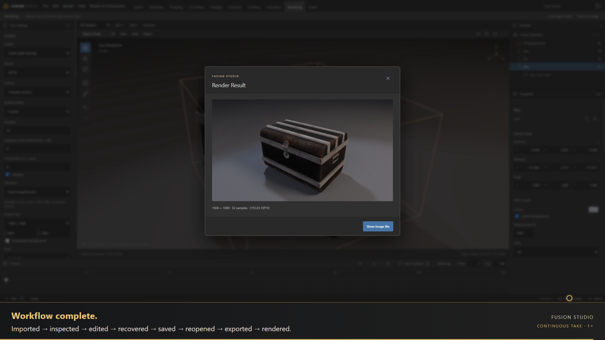

# Fusion Studio — continuous workflow

[1080p workflow MP4](fusion-workflow.mp4) · [English captions](captions.vtt) · [Step overview](contact-sheet.jpg) · [Delivery audit](FINISH.md) · [Verification](verification.json) · [Provenance](provenance.json) · [Timeline](timeline.json)

One continuous, normal-speed recording of packaged **Fusion Studio 0.19.0-rc.1** with fresh user data. Real import and render waits remain. Silent walkthrough; [two-minute cinematic trailer with music](../2026-11-03-remotion/README.md) remains separately available. [Editable Remotion project and commands](../../../videos/fusion-launch/README.md).

About **4 minutes 4 seconds**, 1920 × 1080, 30 fps. Eleven embedded chapters: import 0:02, inspect 0:17, transform 0:39, history 0:47, save 0:55, reopen 1:04, export 1:11, lighting 1:22, render setup/wait 1:28, result 3:57. Render section retains full real-time wait; trailer supplies shorter edited overview.

| Step | Visible action |
|---|---|
| Import | Open installed DAZ `SPowered Trunk.duf`, review compatibility, import working geometry |
| Inspect | Frame asset, orbit, toggle grid and native wireframe |
| Edit | Select root in Outliner; type 25° Y rotation |
| Recover | Undo edit, then redo; exact scene digests checked |
| Save | Type `Trunk Study`; save project version |
| Reopen | Actual File → Open; verify new deserialized objects and exact scene/geometry digests |
| Export | Export actual GLB; show glTF specification validation result |
| Light | Add three-point lighting rig; save lit scene |
| Render | Viewport camera, Cycles/OptiX, 1920 × 1080, 32 samples; wait for actual result |

Capture uses paced Playwright actions against real controls, one CDP recording start/stop, and native frame timestamps. File picker paths are supplied automatically and Explorer reveal suppressed. Gold pointer is an annotation. Remotion **4.0.540** wraps one untrimmed video at 1× with a caption strip below the complete 1920 × 960 app image. No scene injection, simulated responses, deleted waits, montage cuts or retimed actions.

Source `.duf`, textures, project, GLB, raw frames and fresh app profile remain local. Public evidence contains names, hashes, counts and observed outcomes. Source and packaged ASAR hashes match before/after capture. Video-production workflow follows [pinned demo-video-creator attribution](../../../videos/fusion-launch/ATTRIBUTION.md).

**Observed limits:** static converted prop workflow only; this does not certify DAZ rig, native shader, animation or universal roundtrip fidelity. GLB validation returns **0 errors and 1 warning**: `NODE_SKINNED_MESH_WITHOUT_SKIN`; imported prop carries joint attributes without a live skin. Dragon rehearsal imported appearance successfully but its unsupported dependency graph blocked export/render and offered no pause control; dragon remains appearance-only trailer footage. An empty-scene autosave also failed validation during rehearsal. Delivered take opens a valid saved project directly. Failed rehearsals remain local; application runtime and release package remain unchanged. [Release acceptance](../../releases/2026-11-03-rc-report.md) remains separate.
